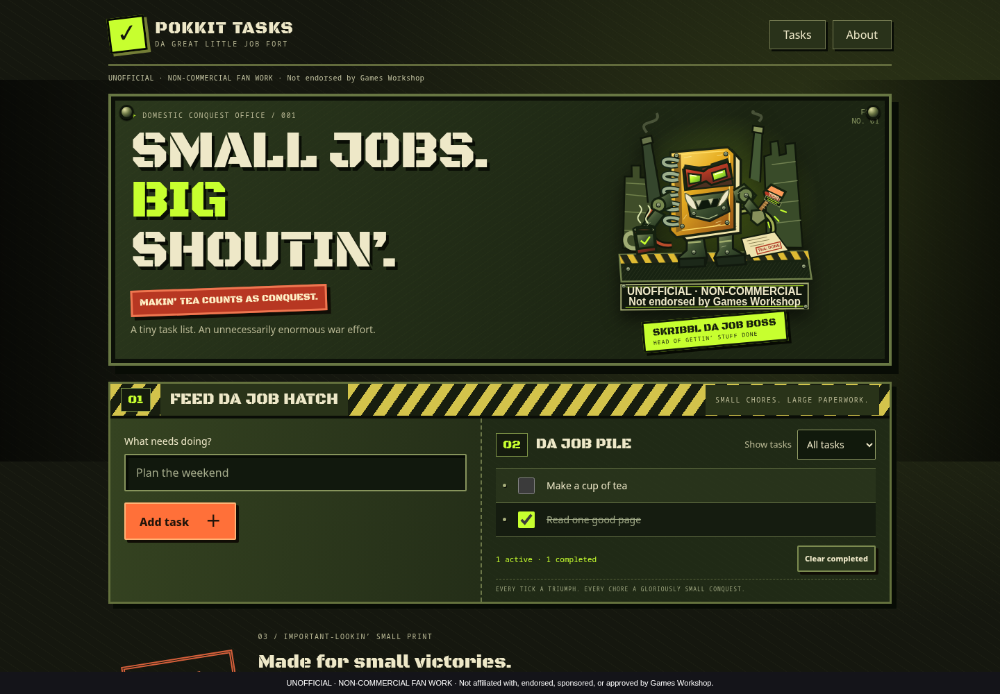
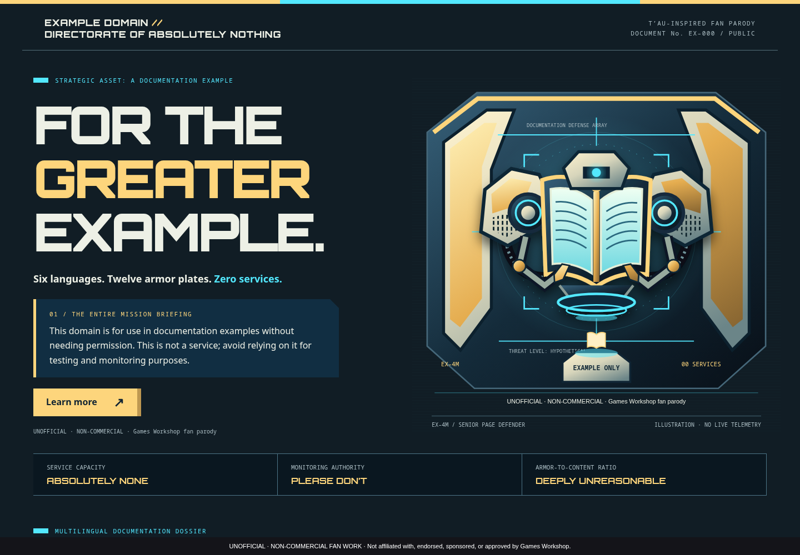

# Agent pipeline verification — v0.3.0

UNOFFICIAL · NON-COMMERCIAL FAN WORK. Not affiliated with or endorsed by Games Workshop. Warhammer 40,000 IP belongs to Games Workshop Limited. Free distribution only; no official artwork or logos.

These are actual pipeline outputs, produced on 2026-11-13 by Codex CLI 0.167.2 with saved ChatGPT sign-in on VM100, using agent-browser 0.35.1. No model API key was supplied. Artwork in these runs was original authored SVG (scalable vector artwork); native image tools are preferred when the selected agent exposes them.

| Input | Mode | Faction | Observed checks |
| --- | --- | --- | --- |
| [example.com](https://example.com) | Rendered URL reconstruction, started through the local studio | T’au Empire | 1440px and 390px layouts, loaded GD Void font, images, full notice, no horizontal overflow or browser errors, original navigation destination, screenshot review |
| [Pocket Tasks source](../examples/pocket-tasks/index.html) | Copied working source app | Orks | 1440px and 390px layouts, loaded GD Stencil font, images, full notice, four original control identifiers, two navigation destinations, add/complete/filter/clear interaction, About navigation |

Both runs finished as `complete`. The URL run passed on its first attempt. The task app used three attempts: visual review detected an overlapping artwork notice and crowded headline, then an oversized notice; the pipeline repaired them and passed the final browser and visual checks. This also exercised increasing the attempt budget through `resume --attempts 3`.

The task application's original JavaScript was preserved byte for byte. Its add/complete/filter/clear check ended with `1 active · 0 completed`, as expected. Its original source file remained unchanged. Browser and visual review results are recorded separately; a run with unresolved issues is labeled `needs-review` instead of being presented as verified.

The automated suite includes a real browser test that exercises a control, then deliberately breaks the notice, navigation and responsive layout and confirms that verification fails. Orchestration tests cover repair, interrupted-run recovery, cancellation, original-file preservation and local-studio request boundaries. CI runs the browser test separately with Chromium installed; it never invokes a model.

Only the captured entry route and listed behaviors were checked. The URL reconstruction has no original server, accounts, payments or backend. These examples do not establish support for every framework or native platform.
